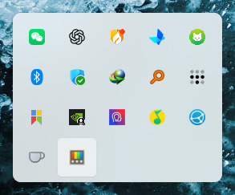
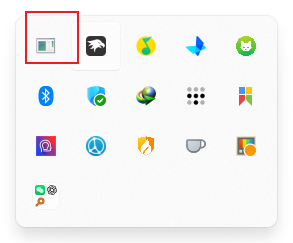
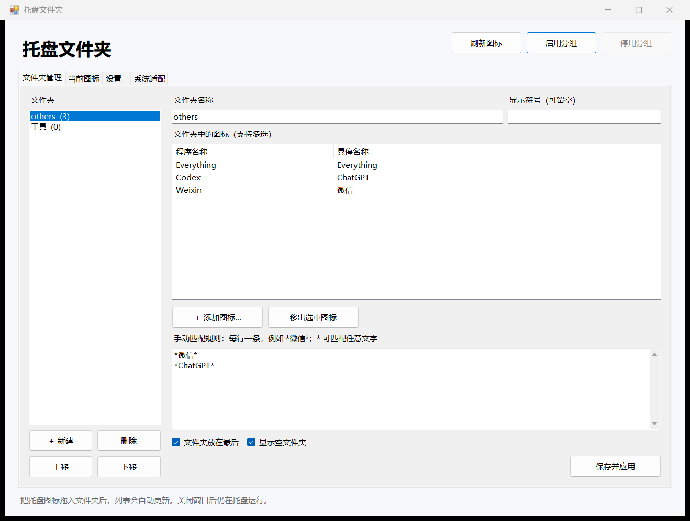

# TrayFolders · 托盘文件夹

**Folders for the Windows 11 hidden-icons flyout.**

Drag to organize · Select icons · Match names · Run independently

[**Download for Windows x64**](https://github.com/zuiyue52/TrayFolders/releases/download/v0.4.2-preview.1/TrayFolders-0.4.2-preview.1-win-x64.zip) · [简体中文](README.md) · [Documentation](docs/README.md) · [Report an issue](https://github.com/zuiyue52/TrayFolders/issues/new/choose)

  

TrayFolders organizes application icons inside **Show hidden icons**, at the right of the Windows taskbar. Create a folder, then drag icons into it, select them from the inventory, or match their names. The application runs independently of Windhawk.

## Grouping in action

| Ungrouped: individual icons | Grouped: a folder previews its members |
| :---: | :---: |
|  |  |

**The folder is at the bottom left of the right-hand image**, with miniature WeChat, ChatGPT and Everything icons. Click a folder to open its members, or drop another icon onto it to add it.

*These are real screenshots from early testing, taken at different times. App counts, themes and the application icon may differ from the current version. The red box in the right-hand image marks the application icon used at that time.*

## Download

| Download | Use |
| --- | --- |
| [**Windows x64 portable app**](https://github.com/zuiyue52/TrayFolders/releases/download/v0.4.2-preview.1/TrayFolders-0.4.2-preview.1-win-x64.zip) | Extract the complete archive and run `TrayFolders.exe` |
| [Matching source archive](https://github.com/zuiyue52/TrayFolders/releases/download/v0.4.2-preview.1/TrayFolders-0.4.2-preview.1-source.zip) | Inspect, modify or build the project |
| [SHA256 checksums](https://github.com/zuiyue52/TrayFolders/releases/download/v0.4.2-preview.1/SHA256SUMS.txt) | Verify the downloaded files |

Current version: **0.4.2-preview.1 (preview)**. [Release notes](https://github.com/zuiyue52/TrayFolders/releases/tag/v0.4.2-preview.1)

Requires **Windows 11 x64, .NET Framework 4.8** and a writable application folder. Initial preparation may download Microsoft symbols. The application UI is Chinese; main usage and development documentation is bilingual.

## Quick start

1. **Extract the entire portable archive** and run `TrayFolders.exe`. Keep its DLL, configuration and helper files together.
2. Under **文件夹管理** (Folder management), click **＋ 新建** (New), name the folder and **保存并应用** (Save and apply).
3. Click **启用分组** (Enable grouping), wait for preparation, then open the Windows hidden-icons flyout once.
4. Drag an icon onto the folder, or use **＋ 添加图标…** (Add icons).

New installations start with empty settings. Exit an older installation first and run only one grouping controller at a time. Closing settings leaves the app running; use **退出并恢复托盘** (Exit and restore tray) to exit completely.

[Full user guide](docs/USAGE.en.md) · [Startup, upgrades and removal](docs/USAGE.en.md#startup-upgrades-and-removal) · [Troubleshooting](docs/COMPATIBILITY.md)

## Features

| Feature | What it does |
| --- | --- |
| Folder management | Create, rename, reorder and delete; display member previews or a custom glyph |
| Drag assignments | Drop onto a folder to add; drop onto the back tile inside it to remove |
| Selection and patterns | Select current icons or match names using `*` and `?` |
| Inventory refresh | Update lists and counts after dragging, or refresh manually |
| Startup and display | Optional login startup and silent launch, DPI scaling and scrolling |

### Settings interface

  

*Screenshot uses test data. Your inventory is read from the current system.*

## Compatibility

The project uses internal Explorer interfaces. Symbol resolution handles some component changes, but **does not guarantee support for every Windows 11 version**. This is a preview; ARM64, 32-bit systems and Windows 10 are outside its scope.

See [compatibility and DLL troubleshooting](docs/COMPATIBILITY.md) for tested and unverified components, and the [validation record](docs/VALIDATION.md) for test coverage.

## Documentation and development

| Looking for | Link |
| --- | --- |
| Usage, matching rules and data locations | [English user guide](docs/USAGE.en.md) · [中文使用手册](docs/USAGE.zh-CN.md) |
| All documentation | [Documentation index](docs/README.md) |
| Building, testing and architecture | [Development guide](docs/BUILD.md) |
| Changes by version | [Changelog](CHANGELOG.md) |
| Bug reports, suggestions and contributions | [Feedback](https://github.com/zuiyue52/TrayFolders/issues/new/choose) · [Contributing](CONTRIBUTING.md) |

## Origins and license

The core derives from **[Ris Peng / RisPNG](https://github.com/RisPNG)**'s [System Tray Folders 1.0.0](https://github.com/ramensoftware/windhawk-mods/blob/a1190b6c1b631a725f6d628189886d410b3760f6/mods/system-tray-folders.wh.cpp), retaining its credits to **[m417z](https://github.com/m417z)**'s tray mods. Native hooking uses **[MinHook](https://github.com/TsudaKageyu/minhook)**.

This project adds the standalone controller, settings UI, persistent drag membership, startup preferences and dynamic adaptation. It is not an official release from Microsoft, Windhawk or the upstream authors.

Project code is **[GPL-3.0-only](LICENSE)**; third-party terms are retained. Distribute matching source and notices with the application. [Full origins and third-party notices](THIRD-PARTY-NOTICES.md)

Maintainer: **c_zh** · [@zuiyue52](https://github.com/zuiyue52)
